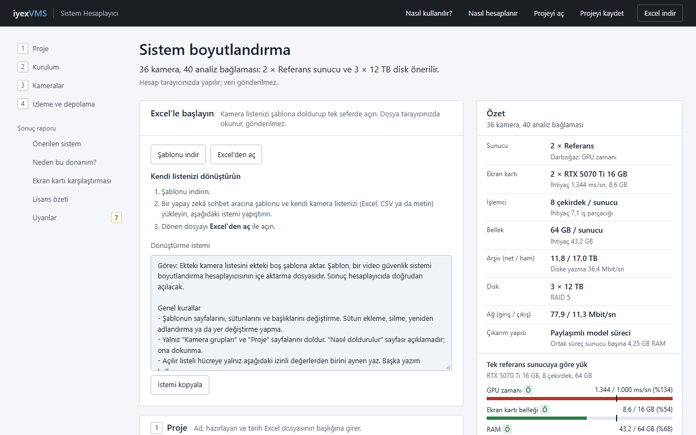
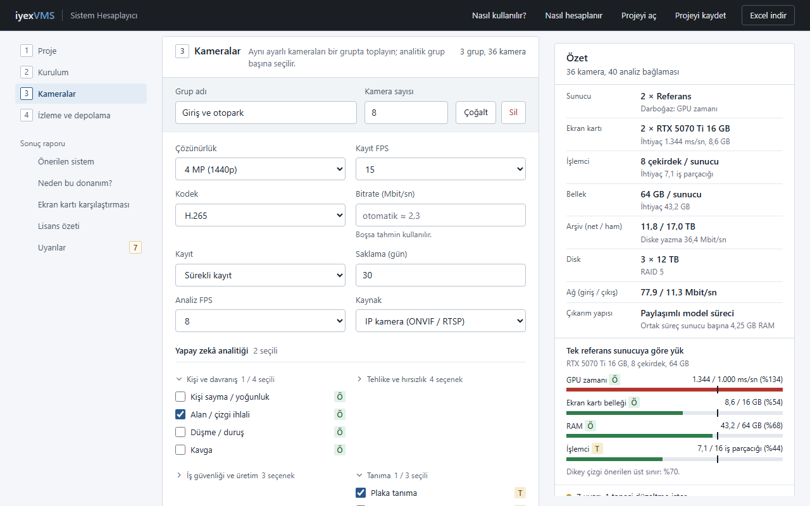
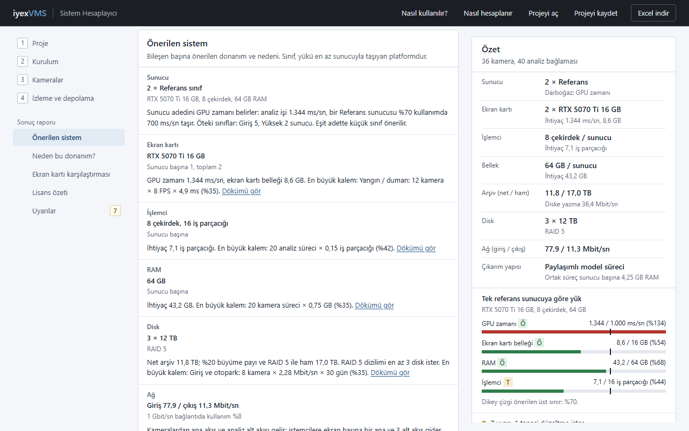
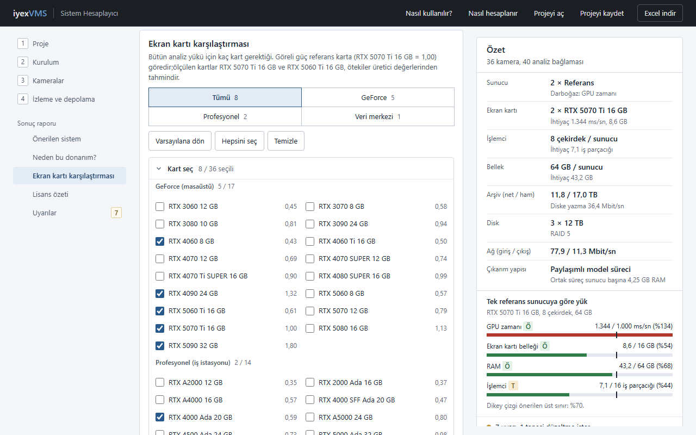
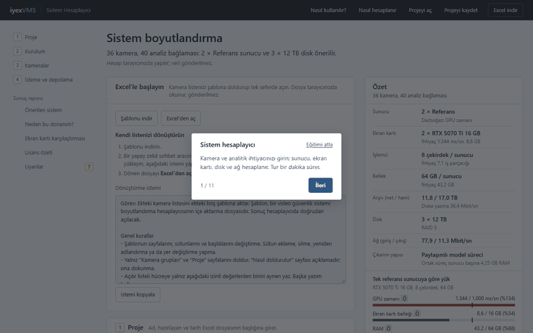

# iyex VMS Sistem Hesaplayici

Statik site: kamera, kayit ve analitige gore sunucu, ekran karti, disk ve ag ihtiyaci.
Bu depo yalniz derlenmis siteyi tasir.

## Ekran görüntüleri

| Kameralar | Sonuç raporu | Ekran kartı karşılaştırması |
|---|---|---|
|  |  |  |

## Kullanım

1. Siteyi açın. İlk açılışta kısa bir tur başlar; **İleri** ile geçin ya da **Eğitimi atla** deyin.
2. **Adım 1–2:** proje adını ve kurulum tipini (tek sunucu, istemci, çoklu sunucu) seçin.
3. **Adım 3:** kamera gruplarını ekleyin: adet, çözünürlük, FPS, kodek, analitik.
4. **Adım 4:** izleme ve depolama süresini girin.
5. Sağdaki **Özet** anında güncellenir. **Sonuç raporu** sunucu, ekran kartı, disk ve ağ önerisini verir.
6. **Excel indir** ile raporu `.xlsx` olarak alın; **Projeyi kaydet** ile sonra yeniden açın.

Yerelde açmak için: `python -m http.server 8101` → http://127.0.0.1:8101/
